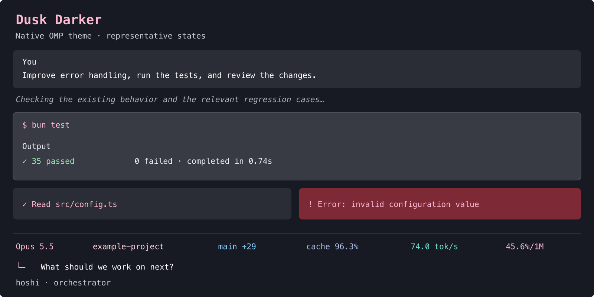

# Dusk Darker

`agent/themes/dusk-darker.json` is a native OMP theme based on Tsuna's Starship `dusk-darker` palette and Ghostty theme. It includes the matching 16-color terminal palette, Markdown and syntax colors, tool states, thinking levels, status segments and HTML-export surfaces.

The dark slot is selected in `config/omp.yml`; `tsuna setup` installs tracked themes into the isolated profile. An existing session can select it from `/settings` → Appearance → Dark Theme. OMP applies theme changes live.

The mapping keeps the charcoal `#171A22` canvas with soft off-white text and takes its roles from Takanashi Hoshino (Blue Archive). Hair pink marks identity: model, tool titles and headings. The composer border follows the reasoning level (OMP's thinking colours), so it changes with the ramp below. The blue left eye is `accent`, so active todos, jobs and subagents are blue. The gold right eye marks warnings, Git dirty state and max reasoning. Reasoning levels run from tie blue through blue eye, hair pink and deep pink to gold. User messages sit on Abydos navy, links use tie blue, and inline code, numbers and cost use Abydos sand. Git clean is green. Teal stays on shell mode, workers and token rate; cache uses lavender and errors red on a dark red wash. `symbolPreset: nerd` in `config/omp.yml` makes icons use Nerd Font glyphs instead of emoji; the setting always overrides a theme's `symbols.preset`. The theme's status spinner uses ring glyphs after her halo. Low-contrast surface colors are reserved for decorative boundaries.

`statusLine.sessionAccent: false` keeps the model accent consistent with the palette. `composer.tokenRate: false` removes the duplicate composer rate while retaining the footer rate.

`composer.shape: kujira` is a Tsuna shape registered by the composer extension: a rounded frame with the status line in the top border and the whale swimming along a closed bottom rule (`╰─  ∿∿∿ ───╯`). The extension also registers `siesta`, which drops the frame for a dotted rule carrying the right status segments, a quiet `›` prompt and the left segments below. Both appear in `/settings` → Composer Shape beside OMP's built-in shapes. With `kujira` or the built-in `box`, the extension closes the whole bottom rule and keeps four empty typing rows, growing to eight visible rows before scrolling. It preserves the draft, cursor, Vim bindings and autocomplete. The default `band` shape has no top-left corner. The partially filled circle next to the model is the compact reasoning-level indicator; `◒` means high.



The preview predates the Hoshino palette and still shows the earlier pink-accent mapping. It uses colors resolved by OMP's native theme loader. Schema validation, profile discovery and loading in truecolor and 256-color modes passed. The checked primary text/background pairs have contrast ratios of at least 4.95:1 in truecolor; the preview is illustrative rather than a capture of a running session.

The terminal palette matches the existing Ghostty theme. The OMP theme does not modify Ghostty's opacity, blur, fonts or other terminal settings.

## Siesta and Abydos Oasis

Two siblings of Dusk Darker share its background roles exactly (user messages, tool states, selection and status line), so only text, accents and spinner glyphs change and Ghostty stays as it is. Each file's `terminal` block records the Ghostty palette for hosts that paint the terminal; OMP itself never sets terminal colours.

- **`siesta`** is the quiet variant: dusty pink for identity, dusty blue for focus, sand for code, sage for success and slightly dimmer text. Its status spinner breathes through `· ∙ • ● • ∙`.
- **`abydos-oasis`** takes its accent choices from Material 3 Expressive on the Dusk charcoal: bloom pink `#FDADCA` for the model, titles and headings, oasis teal `#7FEBE3` as `accent`, sun gold for warnings and code, and lilac for quotes and operators. Its spinner morphs `● ◆ ✦ ✿ ❀`.

Every glyph used is in Maple Mono NF V8. Both themes were rendered with `omp gallery` from an isolated profile and loaded without warnings; neither has been checked in a long live session yet.

## Switching themes

```bash
tsuna theme list            # tracked themes; * marks the active one
tsuna theme current
tsuna theme use siesta
```

`tsuna theme use` accepts any file stem under `agent/themes/`. It sets `theme.dark` in `config/omp.yml` by editing that one line, so comments and other settings stay as they are. When a runtime profile exists it also copies the tracked themes and updates `.runtime/omp/agent/config.yml`, so a full `tsuna setup` is not needed.
